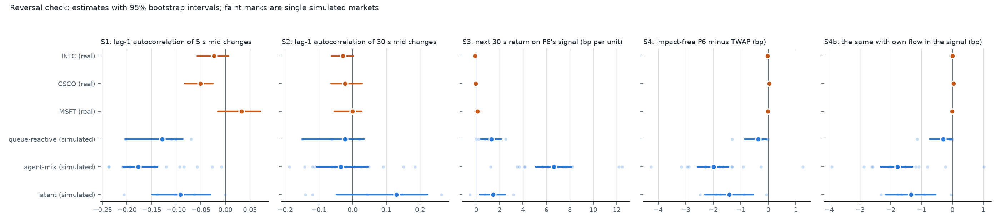

# Is the signal-strategy advantage of the reference markets present in real data? (descriptive check)

14 November 2026. Descriptive. The analysis plan (simrel/reports/reversal_check_plan.md, sha256 8ac3098f...4db3,
commit cff8418) was committed before any real data were on the machine; the simulated side was committed as a table
before the download; the real side was run by a script without this report's author looking at intermediate values.
No code of the engine, the policies or the worlds was changed. No Test B market was read or simulated.

## Result

**The plan's "benchmark property" outcome applies, for all three simulated families.**

- In the simulated markets the public 30 s signal predicts the next 30 s mid return, and P6_signal_reversal earns
  from it with no own impact: the impact-free gap S4 is -0.4 bp (queue-reactive), -2.0 bp (agent-mix) and -1.4 bp
  (latent), each with a 95% interval below zero.
- In INTC, CSCO and MSFT it does not: S4 is -0.03, +0.03 and -0.02 bp, each interval includes zero, and the S3
  slope is -0.11, -0.05 and +0.10 bp per unit of signal against +1.3, +6.6 and +1.4 simulated. Two of the three real
  slopes have the opposite sign and the third is less than a tenth of any simulated value.
- The impact-free gain accounts for all of P6's true simulated advantage. Own impact (S5) adds nothing to it; if
  anything it costs P6 0.1 to 0.7 bp.

So the advantage that makes P6_signal_reversal the usual best strategy in the reference markets is background
predictability that the engine's markets have and these three stocks, on these eight days, do not. It is a
continuation effect (the price keeps moving the way the last 30 s of flow and price went), not a reversal effect;
see "Naming of the signal strategies".

## Naming of the signal strategies

**As coded, P6_signal_reversal is a momentum strategy and P6_signal_momentum is the one that waits.**

- simrel/policies/library.py, SignalAware: the request is clip(1 + gamma x signal, 0.25, 3) times the even pace,
  with signal = 0.5 x (imb + ret), imb = -sgn x signed volume / volume, ret = -sgn x sign(mid change), and sgn = -1
  for a sell. For a sell parent this makes the signal negative after a slice in which the price fell and sellers
  dominated.
- P6_signal_reversal has gamma = -1. After such an adverse slice it requests more than the even pace (1.9 times in a
  direct check with signed volume at -80% of volume and the mid down), and after a favourable slice less (0.25
  times). It trades faster after an adverse move, which pays when moves continue.
- P6_signal_momentum has gamma = +1 and does the opposite: it waits after an adverse move, which pays when moves
  revert.
- The docstring says the reverse ("signal > 0 means the last slice moved against the parent order ... gamma < 0
  waits"). The sign of the signal in the code is opposite to the docstring's description.
- **The costs are correct for the strategies as coded.** Every true cost, regret and best-strategy result of the
  study was computed by running these objects, so the numbers stand. What is affected is the names and any reading
  that relied on them: wherever the study says that "signal reversal" is the best strategy, the strategy that won is
  the one that trades with the last move. Statements that explain its advantage by prices reverting, or by waiting
  for the book to refill after an adverse move, are not supported by the code.
- No code was changed for this check. Whether to rename the strategies or correct the docstring is a decision for
  the team; renaming would touch stored results and frozen files that refer to the names.

## 1. Data

Real: Nasdaq ITCH sample days, 09:45 to 15:45, eight days per stock (2019-01-30, 03-27, 07-30, 08-30, 10-18, 10-30,
12-30, 2020-01-30). All 24 files are present. Each covers the full session, has as many book rows as messages, and
its message count equals the count the converter wrote to its manifest; the converter reported no crossed snapshot
and no unknown order reference on any day. No grid point has a missing quote. Sizes and counts, for comparison with
other copies of the data:

| file | bytes | messages | executions | hidden executions | first message | last message |
|---|---|---|---|---|---|---|
| INTC_2019-01-30.npz | 17,281,872 | 1,219,254 | 28,127 | 2,586 | 09:30:00.002 | 15:59:59.990 |
| INTC_2019-03-27.npz | 21,368,862 | 1,496,351 | 25,935 | 2,141 | 09:30:00.004 | 15:59:59.998 |
| INTC_2019-07-30.npz | 11,828,715 | 833,003 | 20,233 | 2,804 | 09:30:00.000 | 15:59:59.993 |
| INTC_2019-08-30.npz | 14,339,923 | 1,008,120 | 22,312 | 2,344 | 09:30:00.015 | 15:59:59.9995+ |
| INTC_2019-10-18.npz | 12,495,858 | 890,962 | 21,001 | 3,053 | 09:30:00.025 | 15:59:59.984 |
| INTC_2019-10-30.npz | 13,620,844 | 974,888 | 23,682 | 3,323 | 09:30:00.003 | 15:59:59.975 |
| INTC_2019-12-30.npz | 11,043,956 | 784,054 | 19,364 | 3,340 | 09:30:00.004 | 15:59:59.984 |
| INTC_2020-01-30.npz | 23,436,273 | 1,683,268 | 32,220 | 4,416 | 09:30:00.010 | 15:59:59.974 |
| CSCO_2019-01-30.npz | 12,306,885 | 847,699 | 21,921 | 2,402 | 09:30:00.005 | 15:59:59.990 |
| CSCO_2019-03-27.npz | 16,760,580 | 1,167,800 | 24,600 | 3,111 | 09:30:00.003 | 15:59:59.999 |
| CSCO_2019-07-30.npz | 7,892,932 | 550,872 | 10,776 | 2,219 | 09:30:00.002 | 15:59:59.986 |
| CSCO_2019-08-30.npz | 10,791,853 | 753,418 | 20,837 | 3,783 | 09:30:00.008 | 15:59:59.995 |
| CSCO_2019-10-18.npz | 10,302,943 | 720,814 | 14,128 | 2,261 | 09:30:00.002 | 15:59:59.981 |
| CSCO_2019-10-30.npz | 10,175,545 | 704,275 | 16,036 | 2,039 | 09:30:00.045 | 15:59:59.999 |
| CSCO_2019-12-30.npz | 8,047,155 | 559,540 | 11,936 | 2,454 | 09:30:00.122 | 15:59:59.992 |
| CSCO_2020-01-30.npz | 16,291,367 | 1,154,777 | 17,477 | 2,612 | 09:30:00.019 | 15:59:59.975 |
| MSFT_2019-01-30.npz | 23,818,027 | 1,689,121 | 63,232 | 6,132 | 09:30:00.019 | 15:59:59.990 |
| MSFT_2019-03-27.npz | 32,271,198 | 2,269,612 | 50,133 | 4,719 | 09:30:00.001 | 15:59:59.998 |
| MSFT_2019-07-30.npz | 17,779,560 | 1,242,269 | 26,928 | 4,356 | 09:30:00.005 | 15:59:59.960 |
| MSFT_2019-08-30.npz | 23,073,944 | 1,620,007 | 42,112 | 5,912 | 09:30:00.003 | 15:59:59.999 |
| MSFT_2019-10-18.npz | 21,573,534 | 1,484,470 | 56,927 | 8,539 | 09:30:00.001 | 15:59:59.995 |
| MSFT_2019-10-30.npz | 18,431,366 | 1,278,470 | 42,361 | 5,542 | 09:30:00.004 | 15:59:59.995 |
| MSFT_2019-12-30.npz | 18,284,562 | 1,247,983 | 35,028 | 5,019 | 09:30:00.003 | 15:59:59.992 |
| MSFT_2020-01-30.npz | 28,048,876 | 1,914,795 | 84,137 | 18,947 | 09:30:00.002 | 15:59:59.999 |

Simulated: 24 markets (5 queue-reactive, 14 agent-mix, 5 latent): the ten hand-built development markets, the six
XRP pilot markets with the predator off, and the eight XLP pilot markets at lambda = 0. 20 passive episodes of one
hour per market (seeds 70000 to 70019) and 100 truth seeds per market (0 to 99). The list with each market's source
is results/simrel/goal2/reversal_check/markets.json. The Test A markets (R1s, R2s, R3s) would have been allowed but
their parameter listings are not on this machine.

## 2. S1 to S4

Estimates with bootstrap 95% intervals (real: over the 8 days; simulated: over markets, seeds resampled within
markets). S3: slope of the next 30 s mid return (bp) on P6's signal for a sell parent; positive means continuation.
S4: P6_signal_reversal minus TWAP timing cost with no own impact, 15% size, sell parent; negative means P6 is
cheaper. S4b: the same with the trader's own previous child added to the signal's flow, prices still not reacting.

| | S1 | S2 | S3 slope (bp per unit) | S3 t | S4 (bp) | windows P6 cheaper / tie | S4b (bp) | S4, buy parent (bp) |
|---|---|---|---|---|---|---|---|---|
| INTC (real, 8 days, 288 windows) | -0.023 [-0.058, 0.007] | -0.029 [-0.063, 0.003] | -0.11 [-0.29, 0.06] | -1.2 | -0.03 [-0.11, 0.05] | 39% / 1% | 0.01 [-0.08, 0.11] | 0.00 [-0.11, 0.14] |
| CSCO (real, 8 days, 288 windows) | -0.051 [-0.083, -0.025] | -0.022 [-0.063, 0.028] | -0.05 [-0.19, 0.16] | -0.5 | 0.03 [-0.06, 0.12] | 36% / 1% | 0.04 [-0.03, 0.12] | 0.05 [-0.04, 0.13] |
| MSFT (real, 8 days, 288 windows) | 0.033 [-0.015, 0.072] | 0.000 [-0.055, 0.026] | 0.10 [-0.12, 0.37] | 0.7 | -0.02 [-0.06, 0.02] | 41% / 1% | -0.01 [-0.08, 0.06] | -0.02 [-0.11, 0.06] |
| queue-reactive (simulated, 5 markets, 597 windows) | -0.129 [-0.204, -0.087] | -0.023 [-0.150, 0.035] | 1.30 [0.38, 2.15] | 6.5 | -0.36 [-0.86, -0.05] | 33% / 39% | -0.30 [-0.74, -0.02] | -0.34 [-0.77, -0.04] |
| agent-mix (simulated, 14 markets, 1375 windows) | -0.177 [-0.208, -0.138] | -0.035 [-0.106, 0.046] | 6.63 [5.10, 8.18] | 30.6 | -1.98 [-2.57, -1.44] | 69% / 8% | -1.78 [-2.32, -1.29] | -2.02 [-2.58, -1.50] |
| latent (simulated, 5 markets, 600 windows) | -0.091 [-0.149, -0.030] | 0.130 [-0.048, 0.222] | 1.44 [0.30, 2.49] | 8.1 | -1.41 [-2.30, -0.54] | 58% / 2% | -1.34 [-2.18, -0.54] | -1.39 [-2.15, -0.61] |

- **S1.** The simulated markets have more 5 s bounce (-0.09 to -0.18) than the stocks (-0.05 to +0.03).
- **S2.** The 30 s autocorrelation of returns is small on both sides (real -0.03 to 0.00; simulated -0.04 to +0.13,
  intervals including zero). The return sign alone carries little on either side.
- **S3.** The simulated signal predicts continuation in every family, very strongly in agent-mix (t = 31). Since S2
  is near zero, the predictive part of the signal is the order-flow imbalance, not the sign of the return. This is
  an inference from S2 and S3 together; the two components were not regressed separately. In the real stocks the
  slope is indistinguishable from zero (t between -1.2 and +0.7).
- **S4.** P6 is cheaper than TWAP in 69% of simulated agent-mix windows and 58% of latent windows, against 36% to
  41% of real windows (it is more expensive in 58% to 63% of them, by amounts that average out to zero).
- The buy parent gives the same picture on both sides. S4b is close to S4 everywhere.
- By day, the real S3 slope is positive on 3 (INTC), 2 (CSCO) and 4 (MSFT) of 8 days, and S4 is negative on 5, 3
  and 4 days: no consistent sign.

Real data by day:

| stock | day | S1 | S2 | S3 slope | S4 (bp) | windows P6 cheaper |
|---|---|---|---|---|---|---|
| INTC | 2019-01-30 | -0.081 | -0.016 | -0.24 | 0.15 | 33% |
| INTC | 2019-03-27 | -0.029 | -0.072 | -0.57 | -0.11 | 36% |
| INTC | 2019-07-30 | -0.044 | -0.007 | -0.17 | 0.09 | 47% |
| INTC | 2019-08-30 | -0.027 | 0.050 | 0.08 | -0.17 | 50% |
| INTC | 2019-10-18 | -0.060 | -0.125 | -0.25 | 0.07 | 31% |
| INTC | 2019-10-30 | -0.049 | -0.081 | -0.26 | -0.09 | 36% |
| INTC | 2019-12-30 | 0.006 | 0.053 | 0.27 | -0.06 | 42% |
| INTC | 2020-01-30 | 0.029 | -0.017 | 0.21 | -0.14 | 33% |
| CSCO | 2019-01-30 | -0.013 | 0.108 | 0.54 | -0.16 | 39% |
| CSCO | 2019-03-27 | -0.069 | -0.027 | -0.20 | 0.25 | 33% |
| CSCO | 2019-07-30 | -0.069 | -0.065 | -0.19 | 0.09 | 36% |
| CSCO | 2019-08-30 | -0.020 | 0.004 | -0.09 | -0.04 | 31% |
| CSCO | 2019-10-18 | -0.111 | -0.091 | -0.25 | 0.08 | 33% |
| CSCO | 2019-10-30 | -0.111 | -0.094 | -0.23 | 0.10 | 33% |
| CSCO | 2019-12-30 | -0.053 | -0.053 | -0.10 | 0.06 | 33% |
| CSCO | 2020-01-30 | -0.008 | -0.035 | 0.03 | -0.15 | 47% |
| MSFT | 2019-01-30 | 0.036 | 0.048 | 0.37 | 0.02 | 44% |
| MSFT | 2019-03-27 | -0.031 | 0.030 | 0.32 | 0.05 | 39% |
| MSFT | 2019-07-30 | 0.027 | -0.064 | -0.14 | -0.02 | 36% |
| MSFT | 2019-08-30 | -0.015 | -0.030 | -0.10 | -0.11 | 47% |
| MSFT | 2019-10-18 | -0.009 | -0.022 | 0.01 | -0.12 | 47% |
| MSFT | 2019-10-30 | -0.036 | -0.139 | -0.41 | 0.07 | 33% |
| MSFT | 2019-12-30 | 0.060 | -0.006 | -0.05 | 0.02 | 42% |
| MSFT | 2020-01-30 | 0.097 | 0.034 | 0.85 | -0.07 | 36% |

## 3. S5: where P6's simulated advantage comes from

Truth runs at the 15% size, 100 seeds per market. G is the true cost of P6_signal_reversal minus that of TWAP.
"S4 on the same twins" is the impact-free backtest on the unperturbed twin of each truth seed. S5 = G - S4 is what
own impact adds. It splits into own-flow timing (the trader's own child entering the signal, prices not reacting)
and price response (everything that happens because the market reacts to the orders). Negative favours P6.

| family | true gap G | S4 on the same twins | S5 = G - S4 | of which own-flow timing | of which price response |
|---|---|---|---|---|---|
| queue-reactive | 0.44 [-0.70, 2.11] | -0.28 [-0.56, -0.05] | 0.72 [-0.47, 2.53] | 0.06 [-0.01, 0.15] | 0.67 [-0.50, 2.42] |
| agent-mix | -1.72 [-3.59, 0.06] | -2.31 [-3.01, -1.70] | 0.59 [-1.39, 2.39] | 0.17 [0.09, 0.26] | 0.42 [-1.55, 2.21] |
| latent | -1.06 [-1.91, -0.30] | -1.17 [-2.10, -0.35] | 0.12 [-0.08, 0.34] | 0.06 [-0.05, 0.18] | 0.06 [-0.08, 0.20] |

- **Background predictability is the whole advantage.** In agent-mix the impact-free gain on the twins is -2.3 bp
  and the true gain is -1.7 bp. In latent they are -1.2 and -1.1 bp.
- **Own impact does not help P6.** S5 is positive or zero in every family: +0.6 bp in agent-mix (interval -1.4 to
  2.4), +0.1 in latent, +0.7 in queue-reactive. The own-flow feedback costs a little (+0.17 bp in agent-mix,
  interval above zero): speeding up after its own trades is not what makes P6 good. The rest, the response of
  prices to the orders, is +0.4 bp in agent-mix with a wide interval.
- In queue-reactive markets P6 has no true advantage (G = +0.4 bp) and a small impact-free one (-0.3 bp).
- This check cannot test the own-impact channel on real data. In simulation that channel is small and of the wrong
  sign to explain P6's advantage, so the part that cannot be tested is not the part that matters.

Per market:

| market | S1 | S2 | S3 slope | S4 (bp) | true gap G | S4 on twins | S5 | own-flow timing | price response | TWAP cost |
|---|---|---|---|---|---|---|---|---|---|---|
| R1a_qr_resilient | -0.07 | -0.06 | 0.2 | -0.05 [-0.10, -0.01] | -0.03 [-0.22, 0.16] | -0.02 | -0.01 [-0.21, 0.19] | 0.01 | -0.02 | 5.4 |
| R1b_qr_fragile | -0.10 | 0.02 | 2.5 | -1.31 [-1.83, -0.84] | 2.63 [-1.10, 6.41] | -0.57 | 3.20 [-0.52, 6.99] | 0.13 | 3.07 | 26.1 |
| R1c_qr_thin | -0.11 | -0.03 | 1.1 | -0.26 [-0.53, 0.00] | -1.00 [-2.36, 0.31] | -0.30 | -0.70 [-2.12, 0.60] | 0.01 | -0.71 | 16.2 |
| R1d_qr_momentum | -0.20 | -0.15 | 0.7 | -0.22 [-0.44, -0.02] | 0.61 [-1.38, 2.68] | -0.51 | 1.12 [-0.91, 3.14] | 0.13 | 0.99 | 23.2 |
| R1e_qr_deep | undefined | undefined | 0.0 | 0.00 | 0.00 | 0.00 | 0.00 | 0.00 | 0.00 | 5.0 |
| R2a_am_anchored | -0.21 | -0.12 | 8.2 | -2.29 [-3.08, -1.50] | -1.06 [-1.89, -0.23] | -2.70 | 1.64 [0.63, 2.87] | 0.18 | 1.46 | 13.0 |
| R2b_am_trending | -0.17 | 0.01 | 12.2 | -2.89 [-4.27, -1.36] | -1.70 [-3.82, 0.26] | -1.80 | 0.11 [-2.01, 2.18] | 0.31 | -0.20 | 16.9 |
| R2c_am_anchor | -0.14 | 0.09 | 6.1 | -1.77 [-2.57, -1.08] | -0.02 [-1.34, 1.73] | -1.86 | 1.84 [0.55, 3.89] | 0.06 | 1.78 | 9.2 |
| R2d_am_toxic | -0.19 | -0.19 | 1.2 | 1.26 [0.26, 2.21] | -1.54 [-19.90, 16.77] | -2.97 | 1.43 [-17.65, 20.45] | 0.27 | 1.16 | 31.9 |
| R2e_am_calm | -0.06 | -0.06 | 3.5 | -1.31 [-1.63, -1.02] | -0.58 [-1.15, -0.06] | -1.25 | 0.66 [0.22, 1.11] | 0.07 | 0.59 | 8.2 |
| XRP_a01 | -0.19 | -0.11 | 5.7 | -1.33 [-1.74, -0.89] | -0.80 [-1.57, -0.03] | -1.22 | 0.42 [-0.32, 1.10] | 0.22 | 0.21 | 10.2 |
| XRP_a02 | -0.03 | 0.18 | 4.1 | -1.65 [-2.14, -1.23] | -0.21 [-0.95, 0.57] | -1.64 | 1.43 [0.66, 2.21] | 0.15 | 1.28 | 8.1 |
| XRP_a03 | -0.24 | -0.14 | 4.2 | -0.26 [-1.05, 0.51] | -4.36 [-18.96, 5.95] | -2.05 | -2.31 [-16.87, 8.47] | -0.02 | -2.30 | 32.6 |
| XLP_a01 | -0.12 | 0.04 | 7.0 | -2.28 [-2.85, -1.73] | -4.30 [-10.54, -0.88] | -2.01 | -2.30 [-8.46, 1.00] | 0.15 | -2.45 | 12.7 |
| XLP_a04 | -0.08 | 0.15 | 12.5 | -4.26 [-5.22, -3.44] | -3.25 [-5.17, -1.26] | -5.13 | 1.88 [0.12, 3.68] | 0.36 | 1.53 | 13.6 |
| XLP_a06 | -0.01 | 0.02 | 7.4 | -3.16 [-3.77, -2.57] | -1.94 [-2.68, -1.23] | -2.95 | 1.01 [0.48, 1.54] | 0.14 | 0.87 | 6.9 |
| XLP_a09 | -0.24 | 0.05 | 7.6 | -1.92 [-2.51, -1.34] | -1.76 [-2.67, -0.82] | -3.02 | 1.26 [-0.26, 3.61] | 0.15 | 1.11 | 10.5 |
| XLP_a11 | -0.09 | -0.05 | 3.7 | -0.91 [-1.23, -0.58] | -0.65 [-1.26, -0.15] | -0.88 | 0.23 [-0.32, 0.64] | 0.08 | 0.14 | 8.1 |
| XLP_a15 | -0.20 | -0.02 | 7.8 | -2.95 [-3.56, -2.29] | -1.89 [-2.73, -1.10] | -2.88 | 0.99 [-0.20, 2.27] | 0.25 | 0.74 | 15.9 |
| XRP_l01 | -0.10 | 0.15 | 1.4 | -0.88 [-1.50, -0.23] | -0.86 [-1.68, -0.09] | -0.86 | 0.01 [-0.30, 0.34] | -0.02 | 0.02 | 5.0 |
| XRP_l02 | -0.06 | -0.14 | -0.5 | -0.06 [-0.50, 0.36] | 0.15 [-0.27, 0.53] | 0.03 | 0.12 [-0.04, 0.29] | 0.02 | 0.10 | 4.3 |
| XRP_l03 | -0.14 | 0.04 | 1.6 | -2.48 [-3.30, -1.71] | -1.04 [-1.96, -0.16] | -1.16 | 0.12 [-0.29, 0.50] | 0.07 | 0.05 | 8.2 |
| XLP_l01 | -0.21 | -0.12 | 0.7 | -1.90 [-2.57, -1.25] | -1.94 [-2.73, -1.23] | -2.34 | 0.40 [-0.05, 0.83] | 0.25 | 0.15 | 6.3 |
| XLP_l02 | -0.00 | 0.26 | 3.2 | -1.74 [-3.84, 0.15] | -1.60 [-3.72, 0.21] | -1.53 | -0.07 [-0.38, 0.24] | -0.03 | -0.04 | 2.6 |

R1e_qr_deep never moves its mid, so its autocorrelations are undefined. Two collapse-prone agent-mix markets keep
few S4 windows because a side of the book is empty at decision times (R2b_am_trending 38 of 120, R2d_am_toxic 20).

## 4. Tick-size context

| | tick (bp) | spread (ticks) | spread (bp) | time at one tick | S3 slope (ticks per unit) | S4 (ticks) |
|---|---|---|---|---|---|---|
| INTC | 1.85 | 1.01 | 1.87 | 99% | -0.06 | -0.018 |
| CSCO | 2.04 | 1.01 | 2.07 | 99% | -0.02 | 0.015 |
| MSFT | 0.72 | 1.27 | 0.91 | 75% | 0.14 | -0.028 |
| queue-reactive | 10.00 | 1.02 | 10.22 | 98% | 0.13 | -0.036 |
| agent-mix | 9.99 | 1.13 | 11.29 | 94% | 0.66 | -0.199 |
| latent | 10.00 | 1.09 | 10.94 | 91% | 0.14 | -0.141 |

- Every simulated market is large-tick: one tick is 10 bp of the price and the spread is one tick 91% to 98% of the
  time. INTC and CSCO are large-tick stocks in the same sense (spread one tick 99% of the time), but their tick is
  about 2 bp of the price, five times smaller. MSFT is not large-tick (0.7 bp, one tick 75% of the time).
- Comparing like with like, INTC and CSCO against the simulated markets, and measuring in ticks instead of bp to
  remove the difference in tick size: the simulated S3 slope is 0.13 to 0.66 ticks per unit of signal against -0.06
  and -0.02; the simulated S4 is -0.04 to -0.20 ticks against -0.02 and +0.02. In ticks the queue-reactive family is
  no longer far from the stocks on S4 (-0.04 against -0.02), while agent-mix and latent remain five to ten times
  larger and of a sign the large-tick stocks do not share on S3.
- So the conclusion for the agent-mix and latent families does not depend on tick size. For the queue-reactive
  family it does in part: its impact-free gain is small in bp and, in ticks, of the size of the real noise.
- The more negative S1 of the simulated markets is what mid-quote bounce in a 10 bp tick would produce, and is not
  evidence about predictability at 30 s.

## 5. Interpretation, as fixed in the plan

- **Benchmark property: applies.** Each simulated family shows an impact-free gain (S4 interval below zero). No real
  stock does (all three S4 intervals include zero). For S3 the real estimates have the opposite sign (INTC, CSCO)
  or are less than one third of the simulated size (MSFT: 0.10 against 1.30, 6.63 and 1.44). The condition is met
  through S3; on S2 real and simulated are both near zero.
- **Realistic on this point: does not apply.** No stock shows an impact-free gain.
- **No background channel in simulation: does not apply.** The simulated families do show one, and it accounts for
  P6's whole advantage.
- The predictability found in simulation is continuation, not reversal.

What this means for the study, stated as far as the check goes: the result that one fixed strategy without any
simulator beats every simulator in the drawn markets rests on a predictable 30 s drift after order flow that the
reference markets have and these stocks do not show. A benchmark market in which the last 30 s of flow predicts
the next 30 s of price rewards any strategy that trades with that flow. The check does not show that the other
conclusions of the study depend on this property; it shows that the ranking of P6 does.

## 6. Limits

- **Small real sample.** Three liquid large-cap stocks, eight days each, 288 windows per stock. The day bootstrap
  with eight days is rough. The real S4 intervals are narrow (about 0.1 bp wide on each side), so an effect of the
  simulated size (1.4 to 2.0 bp) is excluded with room to spare, but a real effect of a few hundredths of a bp is
  not.
- **One venue.** Quotes and trades are Nasdaq's own book. The signal uses Nasdaq executions only, and the mid is the
  Nasdaq mid, not the national best quote.
- **Hidden executions** are included in the flow with the sign implied by the resting side.
- **Impact-free means price-taking at the mid.** S4 values children at the mid and ignores the spread and depth; it
  measures timing only. That is the same on both sides.
- **Parent size on real data** is 15% of the stock's mean volume per 600 s window (12,600, 9,100 and 18,000 shares);
  impact-free it matters only through rounding to 100 shares.
- **Simulated coverage.** 24 development and pilot markets; the Test A and Test B markets are not included. The
  pilot markets were selected for other purposes (the XLP markets are calm ones whose volatility could be matched).
- **True gaps are noisy in some markets.** The family interval of G in agent-mix is -3.6 to +0.1 bp; three markets
  with high cost noise (R2d, XRP_a03, XLP_a01) dominate its width. S4 on the twins is tight.
- **Which component of the signal predicts** was inferred from S2 and S3, not tested separately.
- **The plan's header carries the date 14 November; it was committed on 13 November at 20:37**, before the code and
  before the download. The file was not edited afterwards, so its checksum stands.
- **Mechanism not established.** The check shows that the predictability is in the simulated markets and not in the
  stocks. It does not show which rule of the worlds produces it (candidates in agent-mix: trend followers and the
  withdrawal of quotes after one-sided flow; in latent: runs of same-sign market orders).

## 7. Files

- Plan: simrel/reports/reversal_check_plan.md
- Code: simrel/metrics/reversal.py, simrel/experiments/reversal_check.py, simrel/tests/test_reversal.py,
  scripts/overnight_reversal.sh
- Results: results/simrel/goal2/reversal_check/ (real_files.csv, real_table.csv, sim_table.csv, combined_table.csv,
  fig_reversal_check.png, markets.json). Raw pickles and the ITCH files are not committed.
