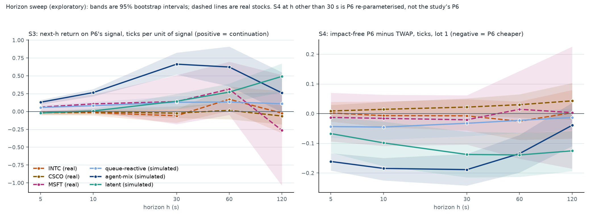

# Horizon sweep for the reversal check (exploratory)

14 November 2026. **Exploratory.** The committed check (simrel/reports/reversal_check.md) used one horizon, 30 s, and
its result was known before this sweep was defined. The definitions were fixed in
simrel/reports/reversal_horizons_plan.md (sha256 dc41d8c9...92cd, commit 282495e) before any number at another
horizon was computed. The committed plan, report and results files are unchanged; everything here is a new file. The
same 24 real files and the same 24 simulated markets and passive episodes are used. No Test B market was read or
simulated.

## Result

**The first reading of the plan applies: the benchmark-property conclusion is strengthened, with two qualifications.**

- **Simulated.** Order-flow continuation is present at every horizon from 5 to 120 s in at least two of the three
  families, and the impact-free gain of P6 (S4, lot 1) is below zero at 5 to 60 s in agent-mix, at every horizon in
  latent, and at 5 to 30 s in queue-reactive.
- **Real.** No stock shows an impact-free gain at any horizon: all 15 intervals of S4 (three stocks, five horizons)
  include zero, and the point estimates are between -0.03 and +0.04 ticks against -0.04 to -0.19 simulated where
  the simulated effect is present.
- **Qualification 1.** The S3 slope of the real data is not zero everywhere. INTC at 60 s is 0.17 ticks per unit
  of signal [0.01, 0.35], the size of the queue-reactive and latent values at that horizon; and MSFT at 5 and 10 s
  is 0.06 and 0.11 ticks with intervals that touch zero, the size of the queue-reactive values. None of these comes
  with an impact-free gain, the neighbouring horizons do not support the INTC value, and with 15 stock-horizon
  intervals one exclusion of zero is expected by chance. They are noted and not counted as continuation.
- **Qualification 2.** "Every horizon" does not hold family by family. Latent shows no continuation at 5 and 10 s
  in S3 (its effect grows with the horizon), and agent-mix and queue-reactive fade by 120 s.
- The one structured feature of the real data is at the shortest horizon and has the opposite sign: in INTC and
  CSCO the sign of the last 5 s return predicts a small reversal (-0.04 and -0.06 ticks, intervals below zero). The
  queue-reactive markets show the same (-0.12 ticks at 5 and 10 s). P6's combined signal does not pick it up in the
  stocks, and P6 as coded trades the other way.

## 1. Reproduction check at 30 s

At h = 30 with lot 100 and the combined signal the sweep recomputes the committed check.

- Inputs: 24 of 24 segments bit-identical (real days) and 480 of 480 segments bit-identical (simulated episodes), comparing the S2 sums, the S3
  arrays and the per-window S4 gaps of every segment with the stored summaries of the committed check. The simulated
  episodes were regenerated from the same seeds and are the same episodes.
- Pooled point estimates against the committed tables (S2, S3 slope and t, S4, share of windows, counts): largest
  absolute difference 3.6e-15, largest relative difference 2.2e-13. They are not bit-identical because the
  committed CSV files store floats to about 15 significant digits; computed in memory from the stored summaries the
  values are the same. The plan said to stop if any number differed; a difference in the fifteenth digit that comes
  from how the committed table was written was judged not to be a difference in the check, and is recorded here.
- Intervals were redrawn with a new random stream, as the plan says, and are close to the committed ones.

| | S2 | S3 slope (bp) | S3 t | S4 (bp), lot 100 | windows | committed interval of S4 | redrawn interval of S4 |
|---|---|---|---|---|---|---|---|
| INTC (real) | -0.0286 | -0.1120 | -1.17 | -0.0328 | 288 | [-0.11, 0.05] | [-0.11, 0.05] |
| CSCO (real) | -0.0219 | -0.0479 | -0.48 | 0.0305 | 288 | [-0.06, 0.12] | [-0.05, 0.12] |
| MSFT (real) | 0.0001 | 0.1020 | 0.75 | -0.0198 | 288 | [-0.06, 0.02] | [-0.07, 0.02] |
| queue-reactive (simulated) | -0.0225 | 1.2960 | 6.53 | -0.3649 | 597 | [-0.86, -0.05] | [-0.88, -0.05] |
| agent-mix (simulated) | -0.0352 | 6.6261 | 30.59 | -1.9833 | 1375 | [-2.57, -1.44] | [-2.56, -1.44] |
| latent (simulated) | 0.1299 | 1.4383 | 8.14 | -1.4132 | 600 | [-2.30, -0.54] | [-2.28, -0.56] |

Table: results/simrel/goal2/reversal_check/horizons_reproduction.csv.

## 2. S3 and S4 across horizons

Ticks are bp divided by the tick size in bp (mean over segments):

| | tick (bp) |
|---|---|
| INTC (real) | 1.87 |
| CSCO (real) | 2.05 |
| MSFT (real) | 0.74 |
| queue-reactive (simulated) | 10.00 |
| agent-mix (simulated) | 9.99 |
| latent (simulated) | 10.00 |

Brackets are bootstrap 95% intervals (real: 8 days; simulated: markets, seeds resampled within markets). Five
horizons, three regressors and two lots give many intervals; no single one is treated as significant on its own.

**S3, combined signal: slope of the next-h return on P6's signal, ticks per unit of signal (positive = continuation)**

| | 5 s | 10 s | 30 s | 60 s | 120 s |
|---|---|---|---|---|---|
| INTC (real) | -0.02 [-0.05, 0.01] | -0.02 [-0.06, 0.02] | -0.06 [-0.16, 0.03] | 0.17 [0.01, 0.35] | -0.02 [-0.30, 0.29] |
| CSCO (real) | -0.02 [-0.05, 0.01] | -0.00 [-0.04, 0.03] | -0.02 [-0.09, 0.07] | 0.02 [-0.11, 0.12] | -0.06 [-0.18, 0.09] |
| MSFT (real) | 0.06 [-0.01, 0.15] | 0.11 [-0.00, 0.24] | 0.14 [-0.18, 0.51] | 0.31 [-0.05, 0.70] | -0.26 [-1.04, 0.51] |
| queue-reactive (simulated) | 0.06 [0.01, 0.09] | 0.08 [0.02, 0.14] | 0.13 [0.04, 0.22] | 0.13 [0.01, 0.24] | 0.11 [-0.04, 0.28] |
| agent-mix (simulated) | 0.13 [0.10, 0.16] | 0.27 [0.21, 0.31] | 0.66 [0.52, 0.82] | 0.62 [0.35, 0.91] | 0.26 [-0.01, 0.55] |
| latent (simulated) | -0.02 [-0.03, -0.00] | 0.01 [-0.02, 0.04] | 0.14 [0.04, 0.25] | 0.27 [0.13, 0.39] | 0.49 [0.27, 0.67] |

t-statistics (clustered by segment):

| | 5 s | 10 s | 30 s | 60 s | 120 s |
|---|---|---|---|---|---|
| INTC (real) | -1.0 | -0.8 | -1.2 | 1.9 | -0.1 |
| CSCO (real) | -1.2 | -0.2 | -0.5 | 0.2 | -0.9 |
| MSFT (real) | 1.4 | 1.6 | 0.7 | 1.5 | -0.6 |
| queue-reactive (simulated) | 10.2 | 9.5 | 6.5 | 3.6 | 1.5 |
| agent-mix (simulated) | 25.0 | 33.1 | 30.6 | 15.3 | 4.0 |
| latent (simulated) | -4.8 | 1.3 | 8.1 | 9.5 | 10.5 |

**S4, combined signal, lot 1: impact-free P6 minus TWAP, ticks (negative = P6 cheaper). Except at 30 s this is P6
re-parameterised to another slice length, not the study's P6.**

| | 5 s | 10 s | 30 s | 60 s | 120 s |
|---|---|---|---|---|---|
| INTC (real) | 0.002 [-0.027, 0.039] | -0.007 [-0.046, 0.041] | -0.008 [-0.057, 0.048] | -0.026 [-0.089, 0.041] | 0.003 [-0.084, 0.079] |
| CSCO (real) | 0.009 [-0.011, 0.029] | 0.014 [-0.009, 0.039] | 0.022 [-0.007, 0.051] | 0.030 [-0.014, 0.065] | 0.043 [-0.020, 0.103] |
| MSFT (real) | -0.013 [-0.094, 0.070] | -0.016 [-0.109, 0.063] | -0.021 [-0.104, 0.062] | 0.014 [-0.152, 0.143] | 0.003 [-0.185, 0.226] |
| queue-reactive (simulated) | -0.044 [-0.082, -0.009] | -0.045 [-0.088, -0.010] | -0.033 [-0.076, -0.005] | -0.023 [-0.066, 0.007] | -0.013 [-0.054, 0.017] |
| agent-mix (simulated) | -0.161 [-0.192, -0.133] | -0.185 [-0.225, -0.150] | -0.189 [-0.242, -0.136] | -0.135 [-0.199, -0.072] | -0.039 [-0.110, 0.036] |
| latent (simulated) | -0.067 [-0.132, -0.011] | -0.099 [-0.177, -0.027] | -0.138 [-0.215, -0.061] | -0.139 [-0.213, -0.064] | -0.125 [-0.194, -0.059] |

Share of windows in which P6 is cheaper (lot 1):

| | 5 s | 10 s | 30 s | 60 s | 120 s |
|---|---|---|---|---|---|
| INTC (real) | 40% | 40% | 39% | 42% | 41% |
| CSCO (real) | 37% | 38% | 33% | 36% | 36% |
| MSFT (real) | 41% | 39% | 41% | 40% | 42% |
| queue-reactive (simulated) | 53% | 47% | 34% | 28% | 28% |
| agent-mix (simulated) | 89% | 85% | 73% | 60% | 47% |
| latent (simulated) | 59% | 60% | 58% | 58% | 53% |

The same two tables in bp, the S2 values and every interval are in results/simrel/goal2/reversal_check/horizons.csv.
S2 for reference:

| | 5 s | 10 s | 30 s | 60 s | 120 s |
|---|---|---|---|---|---|
| INTC (real) | -0.023 | -0.012 | -0.029 | 0.000 | -0.042 |
| CSCO (real) | -0.051 | -0.026 | -0.022 | -0.010 | -0.055 |
| MSFT (real) | 0.033 | 0.046 | 0.000 | -0.044 | -0.062 |
| queue-reactive (simulated) | -0.129 | -0.103 | -0.023 | -0.004 | -0.009 |
| agent-mix (simulated) | -0.177 | -0.144 | -0.035 | -0.066 | -0.154 |
| latent (simulated) | -0.091 | -0.034 | 0.130 | 0.146 | 0.138 |

## 3. Components of the signal

The slope per unit of each component alone, and the backtest with P6 shown one component at its weight of one half.

**S3, order-flow imbalance alone (ticks per unit)**

| | 5 s | 10 s | 30 s | 60 s | 120 s |
|---|---|---|---|---|---|
| INTC (real) | 0.01 [-0.00, 0.02] | 0.01 [-0.02, 0.04] | -0.05 [-0.15, 0.03] | 0.14 [-0.04, 0.34] | 0.15 [-0.29, 0.54] |
| CSCO (real) | 0.02 [-0.01, 0.04] | 0.02 [-0.00, 0.05] | 0.00 [-0.04, 0.06] | 0.09 [-0.07, 0.26] | -0.06 [-0.35, 0.17] |
| MSFT (real) | 0.05 [-0.00, 0.11] | 0.11 [0.00, 0.22] | 0.18 [-0.20, 0.63] | 0.37 [-0.22, 1.14] | -1.05 [-2.09, -0.07] |
| queue-reactive (simulated) | 0.06 [0.01, 0.10] | 0.09 [0.02, 0.16] | 0.19 [0.05, 0.32] | 0.26 [0.08, 0.45] | 0.25 [0.04, 0.49] |
| agent-mix (simulated) | 0.11 [0.08, 0.14] | 0.21 [0.16, 0.27] | 0.68 [0.54, 0.82] | 1.01 [0.78, 1.25] | 0.89 [0.53, 1.26] |
| latent (simulated) | 0.00 [-0.00, 0.01] | 0.01 [-0.00, 0.03] | 0.04 [-0.01, 0.09] | 0.10 [-0.03, 0.21] | 0.21 [0.00, 0.41] |

**S3, sign of the last return alone (ticks per unit)**

| | 5 s | 10 s | 30 s | 60 s | 120 s |
|---|---|---|---|---|---|
| INTC (real) | -0.04 [-0.08, -0.00] | -0.03 [-0.07, 0.00] | -0.04 [-0.12, 0.03] | 0.11 [0.01, 0.22] | -0.03 [-0.21, 0.16] |
| CSCO (real) | -0.06 [-0.08, -0.03] | -0.03 [-0.07, 0.00] | -0.03 [-0.10, 0.06] | -0.01 [-0.09, 0.05] | -0.04 [-0.13, 0.07] |
| MSFT (real) | 0.05 [-0.01, 0.12] | 0.07 [-0.01, 0.16] | 0.08 [-0.12, 0.32] | 0.18 [-0.01, 0.40] | -0.10 [-0.55, 0.37] |
| queue-reactive (simulated) | -0.12 [-0.17, -0.08] | -0.12 [-0.18, -0.06] | -0.05 [-0.16, 0.06] | -0.01 [-0.11, 0.10] | 0.03 [-0.09, 0.17] |
| agent-mix (simulated) | -0.04 [-0.09, 0.02] | 0.07 [-0.00, 0.14] | 0.32 [0.18, 0.48] | 0.24 [0.03, 0.46] | 0.02 [-0.15, 0.20] |
| latent (simulated) | -0.06 [-0.10, -0.01] | -0.02 [-0.10, 0.06] | 0.14 [-0.04, 0.27] | 0.21 [0.03, 0.36] | 0.35 [0.14, 0.55] |

**S4, flow alone, lot 1 (ticks)**

| | 5 s | 10 s | 30 s | 60 s | 120 s |
|---|---|---|---|---|---|
| INTC (real) | -0.010 [-0.030, 0.011] | -0.012 [-0.043, 0.019] | -0.009 [-0.037, 0.023] | -0.008 [-0.039, 0.025] | -0.002 [-0.036, 0.032] |
| CSCO (real) | -0.003 [-0.014, 0.009] | -0.001 [-0.016, 0.014] | 0.005 [-0.011, 0.017] | 0.005 [-0.016, 0.023] | 0.014 [-0.008, 0.040] |
| MSFT (real) | -0.023 [-0.065, 0.022] | -0.019 [-0.079, 0.040] | -0.003 [-0.061, 0.055] | 0.000 [-0.065, 0.055] | 0.006 [-0.036, 0.061] |
| queue-reactive (simulated) | -0.051 [-0.094, -0.010] | -0.052 [-0.095, -0.011] | -0.036 [-0.066, -0.009] | -0.022 [-0.042, -0.006] | -0.010 [-0.020, -0.001] |
| agent-mix (simulated) | -0.157 [-0.183, -0.132] | -0.170 [-0.202, -0.143] | -0.154 [-0.189, -0.123] | -0.108 [-0.141, -0.078] | -0.049 [-0.076, -0.022] |
| latent (simulated) | -0.051 [-0.128, 0.016] | -0.069 [-0.161, 0.018] | -0.081 [-0.172, 0.009] | -0.070 [-0.161, 0.023] | -0.042 [-0.110, 0.033] |

**S4, return sign alone, lot 1 (ticks)**

| | 5 s | 10 s | 30 s | 60 s | 120 s |
|---|---|---|---|---|---|
| INTC (real) | 0.006 [-0.011, 0.022] | -0.000 [-0.022, 0.016] | 0.002 [-0.025, 0.030] | -0.023 [-0.067, 0.020] | 0.006 [-0.071, 0.074] |
| CSCO (real) | 0.010 [-0.004, 0.023] | 0.014 [-0.008, 0.034] | 0.016 [-0.014, 0.045] | 0.023 [-0.013, 0.056] | 0.028 [-0.019, 0.071] |
| MSFT (real) | -0.005 [-0.043, 0.030] | -0.004 [-0.054, 0.045] | -0.018 [-0.062, 0.026] | 0.011 [-0.099, 0.119] | -0.004 [-0.146, 0.158] |
| queue-reactive (simulated) | 0.006 [0.000, 0.014] | 0.005 [-0.005, 0.016] | 0.001 [-0.021, 0.021] | -0.002 [-0.032, 0.020] | -0.004 [-0.035, 0.019] |
| agent-mix (simulated) | -0.010 [-0.017, -0.003] | -0.021 [-0.033, -0.011] | -0.042 [-0.066, -0.018] | -0.029 [-0.064, 0.008] | 0.007 [-0.040, 0.059] |
| latent (simulated) | -0.017 [-0.045, 0.004] | -0.033 [-0.077, -0.000] | -0.071 [-0.139, -0.012] | -0.086 [-0.150, -0.029] | -0.095 [-0.168, -0.033] |

- **Agent-mix: the flow carries it.** The slope on order-flow imbalance is positive at every horizon and grows to
  about 1 tick per unit at 60 s; the flow-alone backtest gains at every horizon (-0.05 to -0.17 ticks). The return
  sign adds a little at 30 s and reverses at 5 s.
- **Queue-reactive: flow continuation against return-sign reversal.** The flow slope is positive at every horizon
  (0.06 to 0.26); the return-sign slope is negative at 5 and 10 s (-0.12). The flow-alone backtest gains at every
  horizon, by small amounts.
- **Latent: the return sign carries it, at longer horizons.** The return-sign slope is negative at 5 s and rises
  to 0.35 at 120 s; the return-alone backtest gains from 10 s up. Flow alone is weak.
- **Real: nothing consistent.** Of the 30 component slopes (three stocks, five horizons, two components), the
  intervals that exclude zero are the 5 s return-sign reversal in INTC and CSCO, INTC's return sign at 60 s
  (+0.11), MSFT's flow at 10 s (+0.11, lower bound 0.00) and MSFT's flow at 120 s (-1.05, the opposite sign). No
  component backtest of any stock has an interval that excludes zero.

## 4. Lot 100 and zero-signal bins

**S4, combined signal, lot 100 (ticks)**

| | 5 s | 10 s | 30 s | 60 s | 120 s |
|---|---|---|---|---|---|
| INTC (real) | -0.055 [-0.126, 0.004] | -0.031 [-0.074, 0.004] | -0.018 [-0.058, 0.024] | -0.030 [-0.090, 0.031] | 0.001 [-0.085, 0.078] |
| CSCO (real) | -0.007 [-0.153, 0.115] | 0.001 [-0.085, 0.081] | 0.015 [-0.026, 0.058] | 0.030 [-0.012, 0.067] | 0.044 [-0.019, 0.104] |
| MSFT (real) | -0.038 [-0.175, 0.098] | -0.034 [-0.123, 0.055] | -0.027 [-0.090, 0.033] | 0.014 [-0.136, 0.138] | 0.002 [-0.186, 0.217] |
| queue-reactive (simulated) | -0.083 [-0.191, -0.001] | -0.061 [-0.136, -0.009] | -0.036 [-0.088, -0.005] | -0.025 [-0.072, 0.007] | -0.013 [-0.055, 0.017] |
| agent-mix (simulated) | -0.245 [-0.315, -0.183] | -0.226 [-0.283, -0.179] | -0.199 [-0.256, -0.144] | -0.139 [-0.207, -0.072] | -0.040 [-0.112, 0.037] |
| latent (simulated) | -0.041 [-0.181, 0.098] | -0.102 [-0.223, 0.019] | -0.141 [-0.228, -0.056] | -0.143 [-0.222, -0.063] | -0.126 [-0.196, -0.059] |

With lot 100 the even pace is below one lot at 5 and 10 s, both schedules wait and then send round lots, and the
values there measure rounding as much as timing: the intervals at 5 s are two to five times wider than with lot 1
and the point estimates shift (INTC -0.055 against +0.002). From 30 s up lot 100 and lot 1 agree. The reading uses
lot 1, as the plan fixed.

**Share of bins in which the combined signal is exactly zero**

| | 5 s | 10 s | 30 s | 60 s | 120 s |
|---|---|---|---|---|---|
| INTC (real) | 42% | 22% | 4% | 0% | 0% |
| CSCO (real) | 48% | 28% | 5% | 1% | 0% |
| MSFT (real) | 12% | 3% | 0% | 0% | 0% |
| queue-reactive (simulated) | 25% | 10% | 2% | 1% | 1% |
| agent-mix (simulated) | 24% | 10% | 2% | 1% | 0% |
| latent (simulated) | 32% | 19% | 16% | 16% | 15% |

**Share of bins with no trade**

| | 5 s | 10 s | 30 s | 60 s | 120 s |
|---|---|---|---|---|---|
| INTC (real) | 42% | 22% | 3% | 0% | 0% |
| CSCO (real) | 49% | 28% | 5% | 1% | 0% |
| MSFT (real) | 13% | 3% | 0% | 0% | 0% |
| queue-reactive (simulated) | 22% | 6% | 0% | 0% | 0% |
| agent-mix (simulated) | 22% | 6% | 0% | 0% | 0% |
| latent (simulated) | 30% | 10% | 0% | 0% | 0% |

**Share of bins with no mid change**

| | 5 s | 10 s | 30 s | 60 s | 120 s |
|---|---|---|---|---|---|
| INTC (real) | 63% | 49% | 30% | 22% | 13% |
| CSCO (real) | 70% | 57% | 36% | 25% | 18% |
| MSFT (real) | 27% | 18% | 9% | 6% | 4% |
| queue-reactive (simulated) | 91% | 87% | 77% | 69% | 59% |
| agent-mix (simulated) | 84% | 78% | 64% | 52% | 37% |
| latent (simulated) | 80% | 70% | 50% | 37% | 27% |

At 5 s the signal is zero in 42% and 48% of the bins of INTC and CSCO, so S3 there rests on the other half. The
simulated mid moves far less often than the real one at every horizon (it does not change in 64% to 77% of 30 s
bins, against 9% to 36% for the stocks), which is the 10 bp tick. In the latent markets about one bin in six has
flow and return of opposite sign that cancel exactly.

## 5. Decay with horizon

- **Agent-mix.** The slope per unit of signal rises from 0.13 ticks at 5 s to 0.66 at 30 s and falls to 0.26 at
  120 s. The impact-free gain is flat from 5 to 30 s (-0.16 to -0.19 ticks), smaller at 60 s and gone at 120 s. The
  predictability lives at 5 to 60 s; 30 s, P6's slice, is at or near its peak.
- **Latent.** No continuation at 5 to 10 s; it builds with the horizon and is largest at 120 s (0.49). The gain is
  about -0.13 ticks from 30 s up. This is a slow drift and not a short-lived flow effect.
- **Queue-reactive.** Small and flat in S3 (0.06 to 0.13); the gain is largest at the shortest horizons (-0.04) and
  fades by 60 s.
- **Real.** There is no profile to compare: the combined-signal slopes scatter around zero at every horizon and the
  backtest is flat at zero. The only decaying feature is the return-sign reversal of INTC and CSCO, present at 5 s
  and gone by 30 s, which is what mid-quote bounce in a one-tick spread produces.
- So the simulated continuation is not a short-horizon effect that P6's 30 s slices happen to catch while real
  markets show it at a faster scale. At 5 and 10 s, where real order-flow effects would be expected to be
  strongest, the stocks show none that the backtest can use.

## 6. Which reading applies

- **Strengthened (first reading): applies**, with the qualifications stated in the result. Simulated continuation is
  present across the horizons and the real data show no impact-free gain at any of them.
- **Real short-horizon predictability absent at 30 s and above (second reading): applies in a limited form.** There
  is a 5 s return-sign reversal in INTC and CSCO. It is not continuation, P6's combined signal does not capture it,
  and it does not produce a gain in the backtest.
- **Real continuation comparable to simulated at some horizon (third reading): not met.** On S4 no stock is
  comparable at any horizon. On S3 two isolated values are of comparable size in ticks (INTC at 60 s; MSFT at 5 and
  10 s, intervals touching zero). The MSFT comparison in ticks is generous to it, because its tick is 0.7 bp against
  10 bp simulated: in bp its 10 s slope is 0.08 against 2.7 for agent-mix.

## 7. Limits

- **Exploratory.** The 30 s result was known, the horizons were chosen after it, and there are many intervals. The
  sweep describes a profile; it does not test a hypothesis.
- **S4 away from 30 s is not the study's strategy.** It is the same rule with a different slice length and number
  of decisions, and the clip lets it move more of the order when there are more decisions.
- **The 5 s grid is the finest available.** Quotes are sampled every 5 s on both sides, so nothing faster than 5 s
  is seen, and at 5 s a bin is one grid step.
- **Ticks flatter the small-tick stock.** Dividing by a 0.7 bp tick makes MSFT's values look larger next to
  simulated markets whose tick is 10 bp. Both units are in the CSV.
- **Simulated windows with an empty side of the book** are dropped when a decision time falls on them; with more
  decisions more are dropped (agent-mix: 1,113 windows at 5 s against 1,375 at 30 s and 1,542 at 120 s), so the
  short-horizon agent-mix values lean towards calmer windows.
- **Small real sample**, one venue, three liquid large-cap stocks, eight days, as in the committed check.
- **The tick size used for conversion** is the mean over segments of tick over mean mid; it differs in the second
  decimal from the pooled value quoted in the committed report (INTC 1.87 against 1.85 bp).
- **Reproduction** is exact on the inputs and agrees to about 13 significant digits on the pooled table values, for
  the reason given in section 1.

## 8. Files

- Definitions: simrel/reports/reversal_horizons_plan.md
- Code: simrel/metrics/reversal.py (horizon, lot and component parameters, defaults unchanged),
  simrel/experiments/reversal_horizons.py, simrel/tests/test_reversal.py
- Results: results/simrel/goal2/reversal_check/horizons.csv, horizons_reproduction.csv,
  horizons_reproduction_inputs.json, fig_reversal_horizons.png
